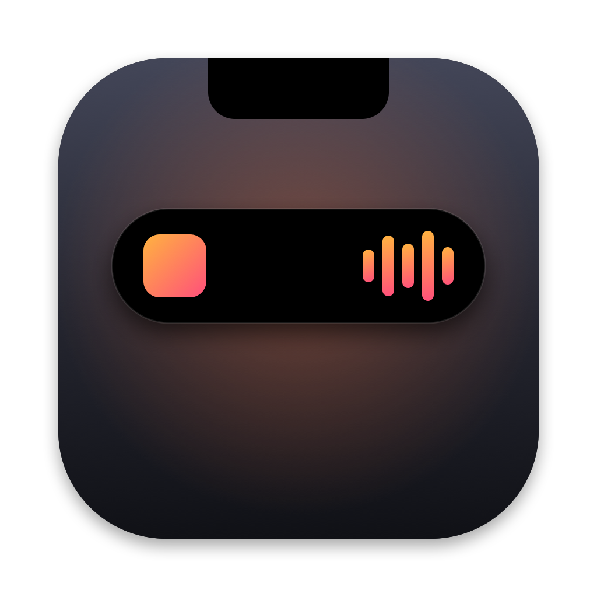

<p align="center">
  
</p>

<h1 align="center">Dynamic Notch</h1>

<p align="center">
  The iPhone's Dynamic Island, but for your MacBook's notch.<br>
  <b><a href="https://github.com/shandilyaswagat/dynamic_notch/releases/latest/download/DynamicNotch.dmg">Download it here</a></b> (free, needs macOS 14 or newer)
</p>

---

So the notch on my MacBook just sits there doing nothing. I wanted it to work like the island on
my phone, so I made this.

When something's going on, the notch stretches out and shows it. When nothing is, it tucks back in
and you forget it's there.

Here's what it shows:

- Whatever music is playing, from any app, with the album art and play/pause/skip
- Timers, counting down right next to the camera
- Calls on FaceTime, Zoom, Meet, Teams and the rest, with how long you've been on
- A heads up when you plug in your charger or your battery gets low
- Your AirPods or headphones connecting
- AirDrop, if you drag files onto the notch

You can make it small, medium or large, whatever looks right on your screen.

It doesn't need an account, doesn't go online and doesn't track anything.

## Installing it

Heads up: I haven't paid Apple for a developer account yet, so the first time you open the app
your Mac will grumble about it. You only have to deal with this once and it takes about a minute.

1. Download [DynamicNotch.dmg](https://github.com/shandilyaswagat/dynamic_notch/releases/latest/download/DynamicNotch.dmg) and open it.
2. Drag **Dynamic Notch** into your **Applications** folder.
3. Go to Applications and double-click **Dynamic Notch**. Your Mac will say it couldn't open it.
   Just hit **Done**.
4. Open **System Settings**, go to **Privacy & Security** and scroll down a bit. You'll see a line
   saying Dynamic Notch was blocked. Click **Open Anyway**, type your password (or use Touch ID)
   and click **Open Anyway** one more time.
5. That's it. The notch will flash **Dynamic Notch · Ready** and you'll get a little capsule icon in
   your menu bar.

If you're comfortable with Terminal, you can skip steps 3 and 4. After dragging the app into
Applications, run this and then open the app like normal:

```bash
xattr -dr com.apple.quarantine "/Applications/Dynamic Notch.app"
```

## Using it

| If you want to | Do this |
|---|---|
| Start a timer or see what's playing | Click the notch |
| See more about something | Click it |
| Close it | Click anywhere else, or just move your mouse away |
| Flip between two things | Swipe left or right on it with two fingers |
| AirDrop some files | Drag them onto the notch |
| Pause a timer, skip a song, open settings | Right-click the notch |
| Change the size or turn stuff off | Click the capsule icon in the menu bar, then **Settings…** |

You'll probably want to switch on **Open at login** in Settings so it's always running.

## Things people ask

**I installed it and nothing's showing up.** That's on purpose. It stays hidden until there's
something to show, like music or a timer. Hover over the notch and it'll puff out a little. Click
it to open it.

**My Mac doesn't have a notch.** It still works. You'll get a small fake notch at the top of the
screen whenever there's something to show.

**My music isn't showing.** Play something and give it a second. The app uses a hidden bit of
macOS to see what's playing. If Apple ever removes that in an update, music will stop showing up
but everything else will keep working.

**Is it safe?** All the code is right here in this repo, so anyone can look through it. The app
never goes online, doesn't collect anything and doesn't ask for any permissions. That warning
during install only shows up because I haven't registered the app with Apple yet. I'm planning to
do that later.

**How do I update it?** Download the new version and drag it into Applications again. Replace the
old one when it asks. Your settings stay put.

**How do I get rid of it?** Click the capsule icon in the menu bar and pick **Quit Dynamic Notch**,
then drag the app from Applications to the Trash. If you want to clear out everything it saved too,
delete `~/Library/Application Support/Dynamic Notch` and
`~/Library/Preferences/com.rectircle.DynamicNotch.plist`.

## What you need

- macOS 14 (Sonoma) or newer
- Works on Apple silicon and Intel Macs, but it's really made for MacBooks with a notch

## Want to build it yourself?

Build steps and notes on how it all fits together are in the [docs folder](docs/README.md).
